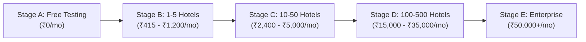

# 🌐 Hosting Platforms Comparison & Cloud Architecture
## QLLEX Technologies — Hotel & Restaurant Management SaaS Portal

Namaste! Agar aap apne Hotel & Restaurant Management SaaS Portal ko **QLLEX Technologies** ke under commercially launch kar rahe hain, toh hosting choose karna sabse critical decision hai. 

Aapka tech stack hai:
- **Frontend:** Next.js 14, React, Tailwind CSS, TypeScript
- **Backend:** Node.js, Express.js, Socket.io (Real-time updates)
- **Database:** MongoDB (Mongoose ORM)
- **Payments:** Razorpay Gateway + Webhooks

Yeh architecture ek specific requirement maangti hai: **Persistent WebSockets (Socket.io) 24/7 bina sleep huye chalna chahiye**, kyunki agar customer table par baitha hai ya kitchen staff order ka wait kar raha hai aur server sleep ho gaya, toh live order notifications fail ho jayenge!

---

## 1. Platform-by-Platform In-Depth Comparison

### A. Frontend Hosting Options (Next.js 14)

| Feature | Vercel (Recommended) | Netlify | Cloudflare Pages |
| :--- | :--- | :--- | :--- |
| **Free Tier?** | ✅ Haan (Hobby Plan) | ✅ Haan (Free Plan) | ✅ Haan (Generous Free) |
| **Free Tier Limits** | 100 GB bandwidth, unlimited builds, non-commercial official TOS | 100 GB bandwidth, 300 build minutes/month | Unlimited bandwidth, 500 builds/month |
| **Next.js Support** | 🌟 Native (Creators of Next.js, best SSR/ISR) | ✅ Achha (via Next.js runtime plugin) | ⚠️ Decent (OpenNext adapter required for SSR) |
| **Custom Domain + SSL** | ✅ Free automatic SSL (Let's Encrypt) | ✅ Free automatic SSL | ✅ Free SSL + Cloudflare CDN |
| **Sleep Inactive?** | ❌ Serverless functions spin down, but cold start is < 200ms | ❌ Similar to Vercel | ❌ Instant edge execution |
| **Commercial SaaS Fit** | 🟢 Best (Upgrade to Pro $20/month (~₹1,650) jab revenue aaye) | 🟡 Good, but Vercel offers faster Next.js features | 🟡 Good for static sites, complex for Next.js SSR |

**Vercel Recommendation:** Next.js khud Vercel ne banaya hai. Vercel par deploy karne se aapko zero configuration lagti hai, automatic previews milte hain, aur automatic CI/CD GitHub push par chal padta hai.

---

### B. Backend Hosting Options (Node.js + Express + Socket.io)

> [!CAUTION]
> **Warning About Render.com Free Tier:** Render ka free tier 15 minutes inactivity ke baad **sleep mode** mein chala jata hai. Jab koi table QR scan karega, toh server ko wake up hone mein 50 se 90 seconds lagte hain! Isliye **Render Free Tier commercial restaurant ke liye strictly UNUSABLE hai**.

| Feature | Railway Paid (Recommended) | DigitalOcean App Platform | Fly.io | Render (Paid) | AWS EC2 (t4g.small) |
| :--- | :--- | :--- | :--- | :--- | :--- |
| **Starting Cost** | **$5/mo (~₹415)** Hobby plan | **$5/mo (~₹415)** Basic (512MB RAM) | ~$5/mo pay-as-you-go | $7/mo (~₹580) Starter | ~$14/mo (~₹1,150) |
| **Sleeps Inactive?** | ❌ **Kabhi nahi** (24/7 Always On) | ❌ **Kabhi nahi** (24/7 Always On) | ⚠️ Default sleeps (config needed to disable) | ❌ Paid tier never sleeps | ❌ Never sleeps |
| **Socket.io Support** | 🌟 **Flawless** (Persistent WebSocket) | 🌟 **Flawless** (HTTP/WebSocket) | ✅ Good (TCP/WebSocket) | ✅ Good | 🌟 Full root control |
| **RAM & CPU** | 512MB RAM, 2 vCPU shared | 512MB RAM, 1 vCPU shared | 256MB–1GB RAM | 512MB RAM, 0.5 vCPU | 2GB RAM, 2 vCPU ARM |
| **Git Auto Deploy** | ✅ GitHub push par auto build | ✅ GitHub push par auto build | ⚠️ CLI se flyctl deploy | ✅ GitHub integration | ❌ Manual setup / CI/CD pipeline |
| **Custom Domain** | ✅ Free with auto-SSL | ✅ Free with auto-SSL | ✅ Free with auto-SSL | ✅ Free with auto-SSL | ⚠️ Manual Nginx + Certbot |

**Railway vs DigitalOcean App Platform:**
- **Railway Hobby ($5/mo):** Setup 2 minute mein ho jata hai. UI intuitive hai, logs real-time dikhte hain, aur environment variables update karte hi zero-downtime redeploy ho jata hai. First 1–10 hotels ke liye **sabse best aur sasta option hai**.
- **DigitalOcean ($5–$12/mo):** Agar aap Indian datacenters (Bangalore) chahte hain taaki latency < 20ms rahe, toh DigitalOcean App Platform Bangalore region choose karna best hai.

---

### C. Database Hosting Options (MongoDB)

| Feature | MongoDB Atlas M0 (Free) | MongoDB Atlas M2 Shared | MongoDB Atlas M5 Dedicated | Self-Hosted MongoDB on VPS |
| :--- | :--- | :--- | :--- | :--- |
| **Cost** | **₹0 (Free Lifetime)** | **$9/month (~₹750)** | **$25/month (~₹2,080)** | Included in VPS cost ($6/mo) |
| **Storage** | 512 MB Storage | 2 GB Storage | 5 GB Storage | 25–50 GB SSD |
| **RAM & vCPU** | Shared RAM | Shared RAM, burstable | Dedicated RAM & CPU | VPS RAM (e.g. 1–2 GB) |
| **Auto Backup** | ❌ No automated snapshots | ✅ Daily snapshots (2 days) | ✅ Daily snapshots (7 days) | ❌ Manual mongodump cron script |
| **Connection Limit**| 500 connections | 1,500 connections | 1,500 connections | Unlimited (OS limit) |
| **Suitability** | Testing & 1–3 pilot restaurants | 5–25 active restaurants | 25–100 active restaurants | Only if you have Linux admin skills |

---

## 2. Five Recommended Production Setups (Stage by Stage)

### Setup A: 100% Free Setup (Only for Development & Internal Testing)
- **Frontend:** Vercel Hobby (Free)
- **Backend:** Railway $5 Free Trial Credit or Fly.io free tier
- **Database:** MongoDB Atlas M0 (Free 512MB)
- **Domain:** Default `.vercel.app` & `.railway.app`
- **Total Cost:** **₹0 / month**
- **Kyun use karein:** Apne dosto aur family members ko demo dikhane ke liye aur initial code testing ke liye. Commercial restaurant ko ispe mat chalana.

---

### Setup B: 1 to 5 Hotels (Low-Cost Commercial Launch) — **RECOMMENDED TO START**
- **Frontend:** Vercel Hobby (Free)
- **Backend:** Railway Hobby Plan — **$5 / month (~₹415)**
- **Database:** MongoDB Atlas M0 (Free) ya M2 ($9/mo if automated daily backups needed)
- **Custom Domain:** `.in` ya `.com` domain (Namecheap / GoDaddy) — **~₹800 / year (~₹67/month)**
- **Total Monthly Cost:** **₹480 to ₹1,230 / month**
- **Kyun suitable hai:**
  - 5 hotels ke total ~50 tables honge.
  - Daily orders around 150–400 honge.
  - Railway ka 512MB instance easily 300 concurrent WebSocket connections handle kar leta hai.
  - Atlas M0 512MB mein 50,000 orders ka data aaram se 6 mahine tak store ho sakta hai.

---

### Setup C: 10 to 50 Hotels (Growing SaaS Business)
- **Frontend:** Vercel Pro — **$20 / month (~₹1,650)** (Commercial license + fast edge network)
- **Backend:** Railway Pro or DigitalOcean App Platform (1GB RAM) — **$12 to $20 / month (~₹1,000–₹1,650)**
- **Database:** MongoDB Atlas M2 or M5 — **$9 to $25 / month (~₹750–₹2,080)**
- **Total Monthly Cost:** **₹3,400 to ₹5,380 / month**
- **Monthly Revenue:** 30 hotels × ₹1,999/mo avg = **₹59,970 / month**
- **Net Profit Margin:** **> 90% profit!**
- **Kyun suitable hai:** Is stage par aapke paas 200+ tables aur thousands of daily diners honge. Dedicated RAM aur daily database backups business continuity ke liye zaruri hain.

---

### Setup D: 100 to 500 Hotels (Scale Phase)
- **Frontend:** Vercel Pro with Team seats (~₹3,500/mo)
- **Backend:** DigitalOcean Kubernetes Cluster or 3x Horizontally Scaled Railway instances with Redis Socket.io Adapter (~₹8,000–₹15,000/mo)
- **Database:** MongoDB Atlas M10 Dedicated Cluster (₹4,800/mo) with automated point-in-time recovery
- **Image Storage:** AWS S3 + Cloudflare CDN (~₹1,500/mo)
- **Total Monthly Cost:** **₹18,000 to ₹30,000 / month**
- **Monthly Revenue:** 250 hotels × ₹1,999/mo avg = **₹4,99,750 / month (~₹5 Lakhs/mo)**
- **Kyun suitable hai:** Multi-instance load balancing ensure karega ki peak lunch/dinner hours (1 PM - 3 PM aur 8 PM - 11 PM) par zero latency rahe.

---

### Setup E: Enterprise Future Setup (1000+ Multi-Chain Brands)
- **Architecture:** AWS EKS (Elastic Kubernetes Service) + AWS Aurora / MongoDB Atlas Enterprise
- **Features:** Multi-region failover, 99.99% uptime SLA, dedicated VPC peering, automated CI/CD with staging environments.
- **Cost:** ₹60,000+ / month
- **Revenue:** ₹20 Lakhs+ / month.

---

## 3. Decision Matrix: Final Verdict for QLLEX Technologies

Aap abhi shuru kar rahe hain, isliye:
1. **Frontend:** **Vercel** par host karein (Fastest, zero devops).
2. **Backend:** **Railway Paid ($5/mo)** use karein (Socket.io 24/7 bina sleep huye chalega).
3. **Database:** **MongoDB Atlas M0 Free** se start karein, aur 3rd paying customer aate hi **Atlas M2 ($9/mo)** par upgrade kar dein daily backups ke liye.

Yeh setup robust hai, secure hai, aur aapka initial monthly expenditure **₹1,000 se kam** rahega!
