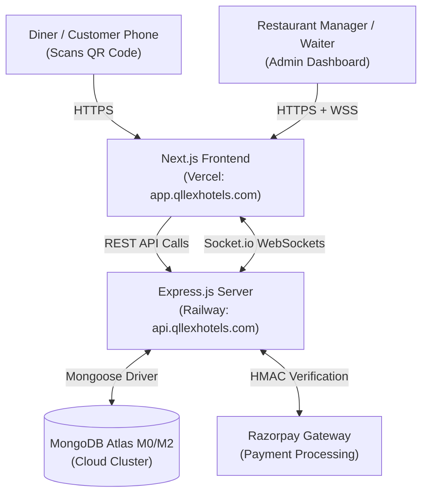

# 🚀 Complete Step-by-Step Deployment Guide
## Deploying Hotel & Restaurant Management SaaS to Production

Yeh guide beginner-friendly Hinglish mein likhi gayi hai. Har step ko exactly waise follow karein jaise bataya gaya hai.

---

## 📋 Pre-Deployment Architecture Overview



---

## STEP 1: GitHub Repository Setup

Aapka project root directory mein do main folders hain:
1. `backend/`
2. `frontend/`

Aap do approaches use kar sakte hain:
- **Approach 1 (Recommended for Beginners):** Ek hi GitHub repository (Monorepo) banayein jisme dono folders hon.
- **Approach 2:** Do alag-alag private repositories banayein: `qllex-hotel-backend` aur `qllex-hotel-frontend`.

Hum **Approach 1 (Single Monorepo)** follow karenge kyunki manage karna bohot aasan hai.

### Terminal Commands to Initialize Git:
Open your terminal in `C:\Users\patel\OneDrive\Desktop\HOTEL MANAGEMENT`:

```powershell
# 1. Initialize git
git init

# 2. Check that .gitignore is properly preventing .env and node_modules from being tracked
git status

# 3. Add all files to staging
git add .

# 4. Make initial commit
git commit -m "feat: complete hotel saas production-ready build"

# 5. Create a new PRIVATE repository on GitHub named 'hotel-restaurant-saas'
# 6. Link and push to your GitHub repo
git branch -M main
git remote add origin https://github.com/YOUR_GITHUB_USERNAME/hotel-restaurant-saas.git
git push -u origin main
```

> [!IMPORTANT]
> Hamesha repository ko **PRIVATE** rakhein! Aapka source code aur proprietary business logic public nahi hona chahiye.

---

## STEP 2: MongoDB Atlas Cloud Setup (5 Minutes)

1. **Sign Up:** [mongodb.com/atlas](https://www.mongodb.com/atlas) par account banayein (Free).
2. **Create Project:** Project name dein: `QLLEX-Hotels`.
3. **Deploy Free Cluster:**
   - Choose **M0 Free** (Shared, 512MB).
   - Cloud Provider: **AWS**.
   - Region: **Mumbai (ap-south-1)** (India ke visitors ke liye ultra-fast response).
   - Cluster Name: `Cluster0`. Click **Create**.
4. **Database Security (User Creation):**
   - Username: `saas_admin`
   - Password: Ek strong password generate karein (e.g. `P@ssw0rd9988_QLLX`) aur save kar lein.
   - Click **Create User**.
5. **Network Access (IP Whitelist):**
   - Click **Network Access** > **Add IP Address**.
   - Select **Allow Access from Anywhere (`0.0.0.0/0`)**.
   - *Kyun?* Railway dynamic IP addresses use karta hai, isliye 0.0.0.0/0 whitelist karna zaruri hai. MongoDB user credentials aur TLS encryption security provide karte hain.
6. **Get Connection String:**
   - Click **Database** > **Connect** > **Drivers** (Node.js).
   - Connection string copy karein:
     ```
     mongodb+srv://saas_admin:<password>@cluster0.abcde.mongodb.net/hotel_management?retryWrites=true&w=majority
     ```
   - `<password>` ko apne actual password se replace karein.

---

## STEP 3: Deploy Backend on Railway (7 Minutes)

Railway par Express aur Socket.io bina kisi extra configuration ke seamlessly chalte hain.

1. **Sign Up:** [railway.app](https://railway.app) par jayein aur GitHub se login karein.
2. **Add Payment Method:** Hobby Plan ($5/mo) activate karne ke liye card add karein (initial $5 credit milta hai).
3. **Create New Project:**
   - Click **New Project** > **Deploy from GitHub repo**.
   - Select your repo: `hotel-restaurant-saas`.
4. **Configure Root Directory:**
   - Settings tab mein jayein.
   - **Root Directory:** Set karein `/backend`.
5. **Configure Start Command:**
   - Build command: `npm install`
   - Start command: `node server.js`
6. **Add Environment Variables (Variables Tab):**
   Railway dashboard mein Variables par click karein aur add karein:

   | Variable Name | Value |
   | :--- | :--- |
   | `NODE_ENV` | `production` |
   | `PORT` | `5000` |
   | `MONGODB_URI` | *Aapka MongoDB Atlas connection string* |
   | `JWT_SECRET` | *64-character random string (generate using Node.js crypto)* |
   | `JWT_EXPIRE` | `7d` |
   | `FRONTEND_URL` | `https://your-frontend-app.vercel.app` *(Step 4 ke baad update karenge)* |
   | `RAZORPAY_KEY_ID` | `rzp_live_xxxxxxxxxxxx` *(ya rzp_test_... testing ke liye)* |
   | `RAZORPAY_KEY_SECRET`| *Aapka Razorpay secret key* |
   | `RAZORPAY_WEBHOOK_SECRET`| *Aapka Razorpay webhook secret* |
   | `UPLOAD_PATH` | `./uploads` |
   | `MAX_FILE_SIZE` | `5242880` |

7. **Generate Domain:**
   - Settings tab mein jayein > **Networking** > **Generate Domain**.
   - Aapko ek public URL milega: jaise `hotel-backend-production-1234.up.railway.app`.
   - Is URL ko browser mein open karein: `https://YOUR_RAILWAY_URL/api/health`
   - Agar response `{ status: "OK", service: "Smart Restaurant & Hotel SaaS API" }` aaye, toh aapka backend successfully live ho chuka hai! 🎉

---

## STEP 4: Deploy Frontend on Vercel (5 Minutes)

1. **Sign Up:** [vercel.com](https://vercel.com) par jayein aur apne GitHub account se sign in karein.
2. **Add New Project:** Click **Add New...** > **Project**.
3. **Import Repo:** Apni `hotel-restaurant-saas` repository select karein.
4. **Project Configuration:**
   - **Root Directory:** Click "Edit" aur select karein `frontend`.
   - **Framework Preset:** Next.js (automatic detect ho jayega).
5. **Environment Variables:**
   Expand **Environment Variables** aur add karein:

   | Variable Name | Value |
   | :--- | :--- |
   | `NEXT_PUBLIC_API_URL` | `https://YOUR_RAILWAY_URL/api` |
   | `NEXT_PUBLIC_SOCKET_URL` | `https://YOUR_RAILWAY_URL` |
   | `NEXT_PUBLIC_RAZORPAY_KEY` | `rzp_live_xxxxxxxxxxxx` *(ya rzp_test)* |

6. **Deploy:** Click **Deploy**. Vercel 1–2 minutes mein build complete karke aapko live URL de dega (e.g., `https://hotel-saas.vercel.app`).

---

## STEP 5: Frontend & Backend Ko Connect Karna (Final Hookup)

Frontend deploy ho gaya, ab backend ko pata hona chahiye ki requests kahan se aa rahi hain:

1. Wapas **Railway Dashboard** mein jayein.
2. `Variables` tab open karein.
3. `FRONTEND_URL` ko change karke apna naya Vercel URL dalein:
   ```
   FRONTEND_URL=https://hotel-saas.vercel.app
   ```
4. Railway automatic zero-downtime redeploy start kar dega.
5. Ab CORS aur Socket.io Vercel ke URL ko safely allow karenge!

---

## STEP 6: Custom Domain Setup (Professional Branding)

Jab aap restaurants ko pitch karenge, toh `vercel.app` ya `railway.app` ke bajaye aapka official brand domain dikhna chahiye, jaise:
- **Customer / Admin Portal:** `app.qllexhotels.com` ya `portal.yourcompany.in`
- **Backend API:** `api.qllexhotels.com`

### Steps:
1. Buy domain from Namecheap / GoDaddy / Hostinger (Cost: ₹499 - ₹899/year).
2. **Vercel Custom Domain:**
   - Vercel Project Settings > **Domains** > Add `app.yourdomain.com`.
   - DNS Provider (GoDaddy/Cloudflare) mein **CNAME Record** add karein:
     - Name: `app`
     - Target: `cname.vercel-dns.com`
3. **Railway Custom Domain:**
   - Railway Service Settings > **Custom Domain** > Add `api.yourdomain.com`.
   - DNS Provider mein **CNAME Record** add karein:
     - Name: `api`
     - Target: *Railway CNAME target*
4. Dono platforms automatic free SSL (HTTPS) certificate 10 minutes mein issue kar dete hain.

---

## STEP 7: Razorpay Webhook Configuration

1. Log in to [Razorpay Dashboard](https://dashboard.razorpay.com).
2. Go to **Settings** > **Webhooks** > **Add New Webhook**.
3. **Webhook URL:** `https://api.yourdomain.com/api/payments/webhook`
4. **Secret:** Ek secret string choose karein aur apne Railway `RAZORPAY_WEBHOOK_SECRET` variable mein update karein.
5. **Alert Events:** Select `payment.captured` and `payment.failed`.
6. Click **Save Webhook**.

---

## STEP 8: End-to-End Live Verification Checklist

Deploy hone ke baad yeh 6 checks zaroor karein:

- [ ] **Health Check:** `https://api.yourdomain.com/api/health` opens and returns HTTP 200 `status: OK`.
- [ ] **Admin Login:** Go to `https://app.yourdomain.com/admin/login` and log in with your credentials.
- [ ] **Create Test Table:** Table add karein aur generated QR code check karein.
- [ ] **Customer QR Scan:** QR code scan karke customer menu open karein. Cart mein items add karein aur order place karein.
- [ ] **Real-Time Notification:** Check karein ki Admin Dashboard mein bina page refresh kiye "New Order" pop-up aaya ya nahi (Socket.io check).
- [ ] **Order Status Update:** Order accept karein ("Preparing" -> "Ready") aur customer ke phone par status live change hote dekhein.

---

## STEP 9: Automatic Future Updates (CI/CD)

Ab aapka system continuous deployment par hai:
- Jab bhi aap code mein koi naya feature banayein ya bug fix karein:
  ```powershell
  git add .
  git commit -m "fix: updated menu layout"
  git push origin main
  ```
- **Vercel aur Railway automatically** code pull karke naya version live deploy kar denge.
- Customers ko zero downtime experience milega!
