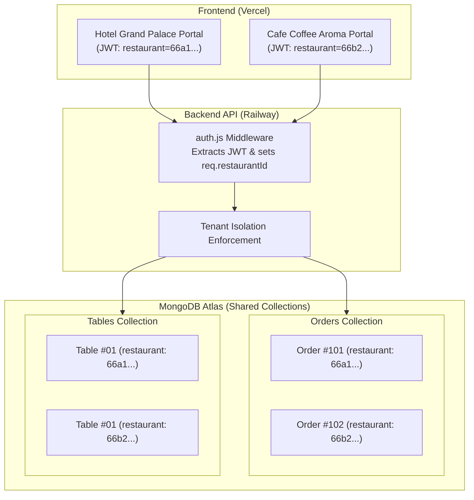

# 🏢 Multi-Tenant Architecture & Hotel Isolation Guide
## Deep Technical Walkthrough for QLLEX Technologies

SaaS ka basic rule yeh hota hai: **"Single software instance, multiple isolated customers"**. 

Aapke project mein multi-tenancy pehle se built-in hai. Is document mein samjhenge ki yeh background mein kaise kaam karti hai, nayi hotels ko kaise onboard karna hai, aur data leaks ko kaise 100% prevent kiya gaya hai.

---

## 1. Multi-Tenancy Architecture Pattern

Aapka application **"Shared Database, Shared Schema with Logical Tenant Isolation"** pattern use karta hai. Yeh pattern duniya ke sabse bade SaaS products (jaise Shopify, Slack, Notion) use karte hain.



---

## 2. Codebase Implementation Breakdown

Aapke database models mein 8 collections hain:
1. `Restaurant` (Tenant metadata, logo, GST %, currency, subscription status)
2. `User` (Staff/Admin accounts linked to `restaurant`)
3. `Category` (Menu categories scoped to `restaurant`)
4. `MenuItem` (Dishes scoped to `restaurant`)
5. `Table` (Dining tables scoped to `restaurant`)
6. `TableSession` (Active dining session scoped to `restaurant`)
7. `Order` (Diner orders scoped to `restaurant`)
8. `Payment` (Bills and payments scoped to `restaurant`)

### Security Guard 1: `auth.js` Middleware
Har authenticated request par `protect` middleware run hota hai:
```javascript
// backend/middleware/auth.js
const user = await User.findById(decoded.id).populate('restaurant');
req.user = user;
req.restaurantId = user.restaurant._id; // <-- Automatically attaches restaurant ID
next();
```
Developer chahe bhi toh kisi doosre hotel ka data query nahi kar sakta, kyunki har controller method mein query filter automatically `req.restaurantId` se bind hoti hai:
```javascript
// Example from orderController.js
const orders = await Order.find({ restaurant: req.restaurantId });
```

### Security Guard 2: Real-time Socket.io Room Isolation
Socket.io mein humne verified room isolation add ki hai:
```javascript
// backend/sockets/index.js
socket.on('join-restaurant', (restaurantId) => {
  if (socket.restaurantId && socket.restaurantId === restaurantId.toString()) {
    socket.join(`restaurant-${restaurantId}`);
  }
});
```
Iska matlab agar Hotel B ka waiter galti se ya janbujh kar Hotel A ka `restaurantId` bheje, toh server silently block kar dega. Hotel B kabhi Hotel A ke live orders ya payment alerts nahi dekh sakta!

---

## 3. How to Onboard a New Hotel (Step-by-Step)

Jab aap koi naya customer sign karein, toh unko access kaise dena hai?

### Method A: Automated Registration API Call (Recommended)
Aap Postman ya ek simple onboarding script se naye hotel ko 30 seconds mein register kar sakte hain:

**Endpoint:** `POST https://api.yourdomain.com/api/auth/register`  
**Headers:** `Content-Type: application/json`  
**Request Body:**
```json
{
  "restaurantName": "The Royal Spice Restaurant",
  "name": "Rajesh Sharma (Owner)",
  "email": "owner@royalspice.com",
  "password": "TemporaryPassword123!",
  "phone": "+91 98765 43210",
  "address": "Shop 14, CG Road, Navrangpura, Ahmedabad, Gujarat"
}
```

### What Happens Automatically in the Database?
Ek hi API call mein backend 4 critical tasks execute karta hai:
1. **Restaurant Record Created:** Unique slug generate hota hai (`the-royal-spice-restaurant-17180...`). Default GST 5% set hoti hai.
2. **Admin User Account Created:** Role `admin` set hota hai with all 6 permissions enabled (`manageMenu`, `manageTables`, `manageOrders`, `viewReports`, `manageStaff`, `managePayments`). Password bcrypt se hash hota hai.
3. **8 Default Categories Populated:** Starters, Main Course, Chinese, Punjabi, South Indian, Fast Food, Beverages, Desserts automatically add ho jati hain.
4. **4 Default Tables Created with QR Codes:** Table 01 se Table 04 auto-create hoti hain aur unka unique QR code image Base64 format mein ready ho jata hai.

Aapko bas customer ko unka login URL aur credentials WhatsApp/Email par bhej dene hain:
- **Login URL:** `https://app.yourdomain.com/admin/login`
- **Email:** `owner@royalspice.com`
- **Password:** `TemporaryPassword123!`

---

## 4. Managing Hotel Subscriptions & Access Control

Har `Restaurant` model mein yeh 3 critical fields hain:
- `isActive` (Boolean: `true` / `false`)
- `subscriptionPlan` (`trial`, `basic`, `pro`, `enterprise`)
- `subscriptionExpiry` (Date)

### Subscription Check Middleware (For Future Enforcement)
Agar aap chahte hain ki subscription expire hote hi hotel ka admin dashboard access pause ho jaye, toh hum ek clean middleware add kar sakte hain:

```javascript
// backend/middleware/checkSubscription.js
const checkSubscription = async (req, res, next) => {
  const restaurant = req.user.restaurant;
  
  if (!restaurant.isActive) {
    return res.status(403).json({
      success: false,
      message: 'Account suspended. Please contact QLLEX Technologies support.'
    });
  }

  if (restaurant.subscriptionExpiry && new Date(restaurant.subscriptionExpiry) < new Date()) {
    return res.status(402).json({
      success: false,
      message: 'Your subscription has expired. Please renew your plan to continue taking orders.'
    });
  }

  next();
};
```

---

## 5. Super Admin Management Strategy

Abhi aapke paas super-admin UI nahi hai, par aapko naye hotels manage karne ke liye kisi complex code ki zarurat nahi hai:

1. **MongoDB Atlas GUI (Compass / Web UI):**
   - Web browser mein MongoDB Atlas open karein.
   - `restaurants` collection mein jakar kisi bhi hotel ka `subscriptionPlan` change kar sakte hain, ya unka `subscriptionExpiry` 30 din aage badha sakte hain.
2. **Phase 2 Roadmap:** Hum baad mein ek dedicated `/superadmin` dashboard banayenge jahan se aap:
   - Sabhi registered restaurants ki list dekh sakein.
   - Total SaaS revenue dekh sakein.
   - Ek click mein naye hotels activate/deactivate kar sakein.
