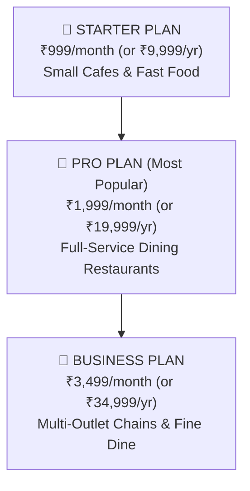

# 💰 Pricing Strategy & Revenue Projections
## Commercial SaaS Monetization Plan for QLLEX Technologies

Indian restaurant market bohot price-sensitive hai. Agar aapne software mehenga rakha, toh restaurants pen-paper par hi rahenge. Agar bohot sasta rakha, toh aap server costs aur support manage nahi kar payenge. 

Isliye humne **"Sweet Spot" Tiered Pricing** design ki hai jo Ahmedabad, Surat, Vadodara, Rajkot aur all-India restaurants ke liye affordable bhi hai aur aapko **>85% gross profit margin** degi!

---

## 1. The 3-Tier Subscription Plans

### Detailed Plan Comparison

| Feature | Starter Plan (₹999/mo) | Pro Plan (₹1,999/mo) ⭐ | Business Plan (₹3,499/mo) |
| :--- | :--- | :--- | :--- |
| **Ideal For** | Cafes, Dhabas, Quick-Service | Family Restaurants, Bars | Hotel Chains, 30+ Tables |
| **Annual Price** | ₹9,999 / year (Save 17%) | ₹19,999 / year (Save 17%)| ₹34,999 / year (Save 17%)|
| **Active Dining Tables**| Up to 10 Tables | Up to 25 Tables | **Unlimited Tables** |
| **QR Code Generation** | ✅ Unlimited | ✅ Unlimited | ✅ Custom Logo QR Codes |
| **Menu Items** | Unlimited Dishes | Unlimited Dishes | Unlimited Dishes |
| **Real-time Order KDS** | ✅ Kitchen & Waiter Live View | ✅ Kitchen & Waiter Live View | ✅ Kitchen & Waiter Live View |
| **Cash Settlement** | ✅ Yes | ✅ Yes | ✅ Yes |
| **Online Payments (Razorpay)**| ❌ (Cash Only) | ✅ **Included** | ✅ **Included** |
| **Daily/Weekly Analytics** | ✅ Basic Summary | ✅ Full Charts + Top Items | ✅ Advanced Export + Trends |
| **Staff Accounts** | 1 Admin + 2 Staff | 1 Admin + 6 Staff | **Unlimited Staff Accounts** |
| **Role Permissions** | Standard | Custom Roles | Custom Roles |
| **Support SLA** | Email Support (24h) | WhatsApp Support (4h) | Dedicated Account Mgr (1h) |

---

## 2. High-Margin Add-On Revenue Streams

Sirf monthly subscription hi nahi, aap ye additional high-profit one-time services bhi offer kar sakte hain:

1. **One-Time Onboarding & Menu Setup Fee:** ₹2,500 – ₹4,000
   - *Aap kya karte hain:* Unka physical menu leke excel ya backend mein 1 ghante mein enter kar dete hain. (Annual subscription lene par ise FREE offer karein deal close karne ke liye!)
2. **Premium Acrylic QR Standees:** ₹100 per table
   - *Cost to you:* ₹35 per standee (local Ahmedabad printer se print karwayein).
   - *Selling price:* ₹100 – ₹150 per standee.
   - *Profit:* 20 tables = ₹1,500 clear profit!
3. **Custom Domain White-Labeling:** ₹2,999 one-time
   - Hotel ka apna subdomain: `menu.theroyalspice.com`.
4. **Thermal Printer Setup / Hardware Consultation:** ₹3,000 setup service.

---

## 3. Financial Scenarios: Revenue vs Hosting Cost vs Net Profit

Assume an average product mix of:
- **60%** customers on Starter (₹999/mo)
- **30%** customers on Pro (₹1,999/mo)
- **10%** customers on Business (₹3,499/mo)
- **Weighted Average Revenue per Hotel (ARPU):** **₹1,549 / month**

---

### Scenario 1: 5 Pilot Hotels (Month 1–2)
- **Gross Monthly Revenue:** 5 × ₹1,549 = **₹7,745 / month**
- **Hosting Expenses:**
  - Railway Hobby: ₹415
  - MongoDB Atlas M0: ₹0 (Free tier)
  - Domain / Misc: ₹100
  - **Total Expenses:** **₹515 / month**
- **Net Monthly Profit:** **₹7,230 / month** (93% Net Margin)

---

### Scenario 2: 10 Active Hotels (Month 3–4)
- **Gross Monthly Revenue:** 10 × ₹1,549 = **₹15,490 / month**
- **Hosting Expenses:**
  - Railway Hobby: ₹415
  - MongoDB Atlas M2 (Automated backups): ₹750
  - Domain / SSL: ₹100
  - **Total Expenses:** **₹1,265 / month**
- **Net Monthly Profit:** **₹14,225 / month** (92% Net Margin)

---

### Scenario 3: 25 Active Hotels (Month 5–6)
- **Gross Monthly Revenue:** 25 × ₹1,549 = **₹38,725 / month**
- **Hosting Expenses:**
  - Railway Pro: ₹1,650
  - MongoDB Atlas M2: ₹750
  - Vercel Pro: ₹1,650
  - WhatsApp Business API (Twilio/Wati): ₹1,000
  - **Total Expenses:** **₹5,050 / month**
- **Net Monthly Profit:** **₹33,675 / month** (87% Net Margin)

---

### Scenario 4: 50 Active Hotels (Month 8–10)
- **Gross Monthly Revenue:** 50 × ₹1,549 = **₹77,450 / month**
- **Hosting Expenses:**
  - Railway Pro (Scales to 2GB): ₹2,500
  - MongoDB Atlas M5: ₹2,080
  - Vercel Pro: ₹1,650
  - Support & Admin Costs: ₹3,500
  - **Total Expenses:** **₹9,730 / month**
- **Net Monthly Profit:** **₹67,720 / month (~₹8.1 Lakhs/year)**

---

### Scenario 5: 100 Hotels (Scale Milestone — Year 1 End)
- **Gross Monthly Revenue:** 100 × ₹1,549 = **₹1,54,900 / month (~₹1.55 Lakhs/month)**
- **Hosting Expenses:**
  - DigitalOcean / Railway Multi-Instance: ₹6,000
  - MongoDB Atlas M10 Dedicated: ₹4,800
  - Vercel Pro: ₹1,650
  - Customer Support Intern (Part-time): ₹12,000
  - **Total Expenses:** **₹24,450 / month**
- **Net Monthly Profit:** **₹1,30,450 / month (~₹15.6 Lakhs/year pure profit!)**

---

## 4. Break-Even Analysis

Aapko business profitable banane ke liye kitne customers chahiye?

$$\text{Fixed Monthly Hosting Cost} = \text{₹515 (Railway Hobby)}$$
$$\text{Average Monthly Subscription} = \text{₹1,549}$$

$$\text{Break-Even Customers} = \frac{\text{₹515}}{\text{₹1,549}} = \mathbf{0.33 \text{ Customers!}}$$

**Matlab sirf 1 single paying hotel aate hi aapka pura cloud infrastructure 100% self-funded ho jata hai!** Baaki aane wale saare hotels se aane wala 90%+ paisa seedha aapka profit hoga.
