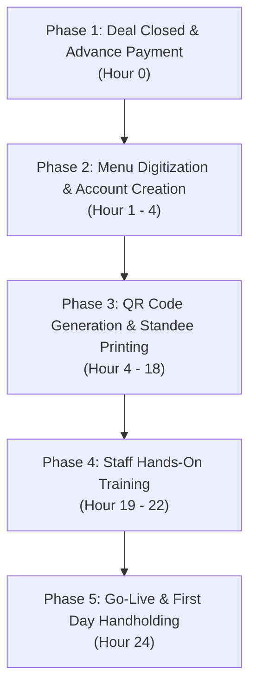

# 🤝 Complete Customer Onboarding Guide
## Step-by-Step SOP from Lead Conversion to Go-Live Day

Restaurant owners tech-savvy nahi hote. Agar onboarding smooth nahi hui, toh woh software chhod kar wapas purane kache paper bill par chale jayenge. 

Is guide mein **QLLEX Technologies** ka exact Standard Operating Procedure (SOP) diya gaya hai jisse aap kisi bhi restaurant ko **24 hours ke andar** fully live kar sakte hain!

---

## 1. The 5-Phase Onboarding Timeline



---

## Phase 1: Deal Closing & Account Setup (Hour 0)

Jab restaurant owner agree kare:
1. **Contract/Invoice:** Digital invoice generate karein (Advance 1 month or 1 year).
2. **Collect Details via a Simple WhatsApp Form:**
   - Restaurant Name: (e.g. *Spice Villa Restro & Cafe*)
   - Owner Name & WhatsApp Number:
   - Official Email Address:
   - Physical Address & City:
   - GST Number (if applicable):
   - Service Charge % (Default 0% or 5%):
   - Photos of current physical paper menu (Front & Back).
3. **Register Tenant:** Backend register endpoint call karke credentials generate karein.

---

## Phase 2: Menu Digitization (Hour 1 to 4)

Menu upload karna onboarding ka sabse important step hai:
1. Log in to the newly created admin account.
2. Go to **Categories**: Create their custom categories (e.g., *Soups, Tandoori Starters, Paneer Specials, Breads, Mocktails*).
3. Go to **Menu Items**:
   - Dish Name, Category, Price, Food Type (*Veg, Non-Veg, Egg*).
   - Preparation Time (e.g. *15 mins*).
   - High-quality dish images (unsplash.com se standard food images ya unke actual dish photos).
4. **Tip:** Pehle din 100 items ka full menu enter karne ke bajaye, unke **top 30 bestsellers** turant daal dein taaki system 2 ghante mein ready dikhe!

---

## Phase 3: Table Configuration & QR Standees (Hour 4 to 18)

1. Go to **Tables** in Admin Portal.
2. Number of tables setup karein (e.g., Table 01 to Table 20).
3. Click **"Download QR Code"** for each table.
4. **Printing Guidelines for Restaurant:**
   - **Size:** $4 \times 6$ inches (Standard table standee size).
   - **Material:** 3mm Acrylic Base Standee or Matte PVC Card.
   - **Template Design:**
     - Top: Restaurant Logo.
     - Center: Clear QR Code.
     - Text below: *"Scan here to view digital menu & place order"*
     - Bottom: *"Powered by QLLEX Technologies"*.
   - **Local Print Shop Cost:** ₹35 – ₹50 per acrylic standee in Ahmedabad.

---

## Phase 4: Staff Training Checklist (Hour 19 to 22)

Training sirf 45 minutes ki hoti hai. Teen groups ko alag-alag 15-minute training dein:

### Group 1: Waiters & Captains
- [ ] Table par customer ko scan karne ke liye kaise bolna hai: *"Sir, aap phone se QR scan karke direct photo menu dekh sakte hain."*
- [ ] Agar customer ke paas internet nahi hai, toh restaurant ka WiFi password provide karein.
- [ ] Admin Portal > **Orders Tab**: Jab naya order pop-up aaye aur bell ring ho, toh **"Confirm Order"** par click karein.
- [ ] Jab khana serve ho jaye, toh **"Mark as Served"** karein.

### Group 2: Kitchen Staff / Chef (KDS View)
- [ ] Kitchen tablet / screen par **Active Orders** open karein.
- [ ] Naya order aane par table number aur special instructions (e.g. *"less spicy, no onion"*) check karein.
- [ ] Dish ready hone par **"Mark as Ready"** button click karein taaki waiter ko notification mile.

### Group 3: Cashier / Manager
- [ ] Customer khana khatam kare toh **"Generate Bill"** par jayein.
- [ ] Agar customer cash de raha hai: Click **"Receive Cash Payment"**.
- [ ] Bill print ya digital receipt share karein.
- [ ] Check karein ki Table status **"Available"** ho gaya for the next customer.

---

## Phase 5: Go-Live Support (Day 1)

1. Pehle din lunch time (1 PM to 3 PM) par aap ya aapka team member restaurant mein physical present rahein.
2. Observe karein ki customers QR scan karte waqt kahan hesitate ho rahe hain.
3. Waiters ko pehle 5 orders live execute karwayein.
4. Owner ko dinner ke baad **Daily Revenue Summary Report** dikhayein:
   - *"Sir, aaj QR code se total 34 orders aaye aur ₹18,450 ka business hua!"*
5. Owner ka confidence pehle din hi 100% build ho jata hai!

---

## 📧 Ready-to-Use Welcome Message (WhatsApp / Email Template)

```text
Subject: Welcome to QLLEX Smart Dining Portal — Login Details & Next Steps

Dear Rajesh Ji,

Congratulations! Your restaurant "The Royal Spice" is now officially digitized with QLLEX Technologies.

Here are your official Admin Dashboard credentials:
🔗 Admin Portal URL: https://app.qllexhotels.com/admin/login
👤 Username / Email: owner@royalspice.com
🔑 Temporary Password: TemporaryPassword123!

Next Steps for Today:
1. Please log in and change your temporary password.
2. Review your 20 pre-loaded menu dishes.
3. Our technical team is visiting today at 4:00 PM for the 30-minute staff training and table QR standee placement.

For any immediate assistance, our priority WhatsApp support line is: +91 98765 XXXXX.

Warm Regards,
Customer Success Team
QLLEX Technologies | Ahmedabad
```
