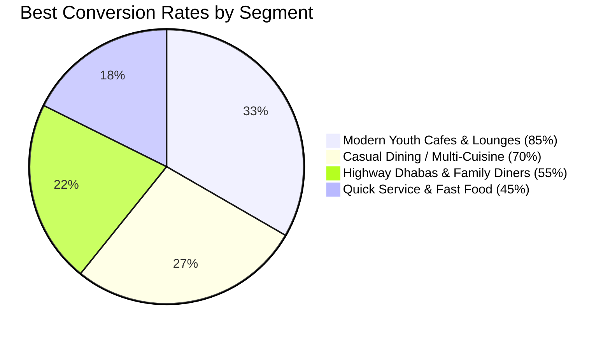
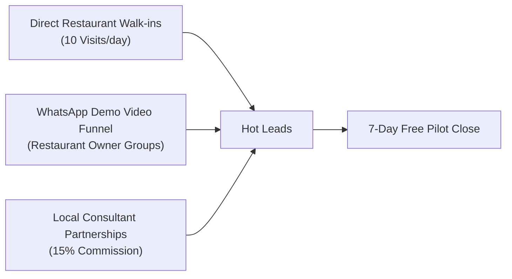

# 🎯 Hotel & Restaurant Sales Strategy (Gujarat Focus)
## How to Close Your First 25 Restaurant Clients in 60 Days

Technology bechna ek baat hai, aur restaurant owner ko convince karna dusri baat. Restaurant owners bohot busy hote hain; unke paas lambi presentation dekhne ka time nahi hota.

Is guide mein **QLLEX Technologies** ke liye field-tested sales strategies hain jo Ahmedabad (CG Road, Prahlad Nagar, Sindhu Bhavan Road, Bodakdev, Maninagar) aur across Gujarat directly kaam aayengi.

---

## 1. Target Customer Segments: Kisko Target Karein?

1. **Category A: Modern Cafes & Lounges (Highest Conversion):**
   - *Example:* Rooftop cafes, tea/coffee bars, youth hangouts.
   - *Kyun easily convert hote hain:* Unka crowd smartphone-friendly hai. QR ordering unke aesthetic aur modern vibe ke sath match karti hai.
2. **Category B: Multi-Cuisine Family Restaurants (Best Retainers):**
   - *Example:* Punjabi, Kathiyawadi, South Indian, Chinese family restaurants (15–30 tables).
   - *Kyun zarurat hai:* Weekend rush mein waiters kam padte hain; customers wait karke gusse hote hain. QR code se order turant kitchen chala jata hai!
3. **Category C: Highway Restaurants & Dhabas:**
   - *Example:* SG Highway, Sanand road, Baroda highway restaurants.
   - *Pain Point:* Staff turnover bohot high hota hai (waiters aate-jaate rehte hain). System unki waiter dependency 40% kam kar deta hai.

---

## 2. The 5-Minute "Live Mobile Demo" Pitch

Kabhi bhi laptop khol kar presentation mat do. Seedha apne phone par live demo dikhao:

### Step 1: Entry & Icebreaker (1st Minute)
- *"Namaste sir! Main QLLEX Technologies, Ahmedabad se hoon. Hum local restaurants ko smart QR dining system provide karte hain jisse weekend rush mein waiter ke bina bhi customer direct phone se order de sakta hai."*
- *"Sir, main bas 2 minute mein dikhaata hoon ki customer ke phone mein yeh kaisa dikhta hai."*

### Step 2: The Magic "Aha!" Moment (2nd–3rd Minute)
- Apne phone par apna pre-configured demo QR standee rakhein.
- Owner ke phone ka camera open karwayein aur scan karein:
  - *"Sir, dekhiye na koi app download karni padi, na register karna pada. Seedha aapke restaurant ka photo menu open ho gaya!"*
- Dish cart mein add karein aur "Place Order" dabayein.
- **Boom!** Aapke dusre phone (ya tablet) par **Order Notification Bell** bajti hai!
- *"Sir dekhiye, customer ne order dabaya aur kitchen tablet par instant notification aa gaya with Table number!"*

### Step 3: Owner ROI Calculation (4th Minute)
- *"Sir, aapke yahan weekend par 4 waiters hote hain. Agar 2 tables se order bina waiter ke seedha kitchen chala jaye, toh aapka table turnover 15 minutes fast ho jayega. Ek extra table ghumne ka matlab roz ka ₹1,500 extra munafa!"*

### Step 4: No-Brainer Closing Offer (5th Minute)
- *"Sir, software ka charge sirf ₹1,999/month hai (roz ka sirf ₹65, yani ek chai aur maska bun ka kharcha!)."*
- *"Aapko risk na ho, isliye main pehle 7 din aapko 100% Free Trial de raha hoon, standees hum laga kar denge. Pasad aaye toh 8ve din continue karna, nahi toh koi charge nahi!"*

---

## 3. Objection Handling: Tough Questions Ke Smart Answers

### Objection 1: *"Bahut mehenga hai, hum pen-paper par theek hain."*
- **Smart Response:** *"Sir, pen-paper par waiter ki handwriting kharab hoti hai toh galat dish ban jati hai, aur roz ka ₹200–₹500 ka food waste hota hai. Hamara software roz ka sirf ₹65 leta hai aur food billing errors ko 0% kar deta hai. Pura software toh waste bacha kar hi free ho jata hai sir!"*

### Objection 2: *"Hamare waiters padhe-likhe nahi hain, wo phone nahi chala payenge."*
- **Smart Response:** *"Sir, kya aapke waiters WhatsApp aur YouTube chalate hain? Hamara admin panel WhatsApp se bhi aasan hai! Sirf ek green button dabana hota hai order accept karne ke liye. Hum khud 30 minute mein sabhi staff ko trained karke jayenge."*

### Objection 3: *"Agar restaurant mein internet band ho gaya toh?"*
- **Smart Response:** *"Sir, aajkal har customer ke phone mein 5G Jio/Airtel hota hai. Aur restaurant ke kitchen tablet ke liye ek chota ₹499/month ka WiFi router 100% sufficient hota hai. Aur kisi emergency mein purana manual system toh hamesha backup ke liye hai hi!"*

### Objection 4: *"Zomato / Swiggy par hum already hain, iski kya zarurat?"*
- **Smart Response:** *"Sir, Zomato/Swiggy har order par 20% se 30% commission kaat leta hai. Hamara QLLEX portal aapka **khud ka private portal** hai. Chahe aap 10 Lakh ka order lein, hamara charge fixed ₹1,999 hi rahega, ZERO percent commission!"*

---

## 4. Scalable Lead Generation Channels in Gujarat

1. **Direct Walk-Ins (The Gold Mine):**
   - Roz dopahar **3:30 PM to 6:00 PM** ke beech mein visit karein. Yeh lunch aur dinner ke beech ka silent time hota hai jab owner counter par free baitha hota hai.
   - Target: 10 restaurants daily $\times$ 25 days = 250 restaurants. 10% conversion = **25 Paying Clients in 2 months!**
2. **Local CA / Accountant Partnerships:**
   - Gujarat mein restaurant CAs ke paas 20–50 restaurant accounts hote hain.
   - Unhe offer karein: *"Sir, aapke client ko hum automated GST billing portal denge, aapko har month unke subscription par 15% recurring commission milega."*
3. **WhatsApp Video Funnel:**
   - Ek 45-second ka crisp video banayein: QR scan $\rightarrow$ Dish select $\rightarrow$ Order ring on kitchen screen.
   - Text message: *"Kya aapka restaurant weekend rush mein slow ho jata hai? Get QLLEX Smart QR System today. Call for free 7-day demo."*
