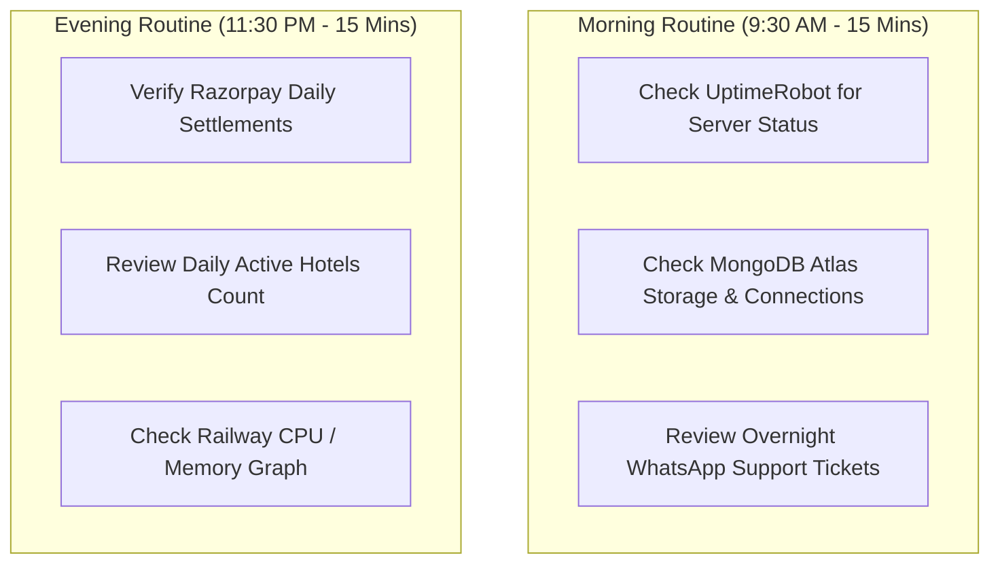
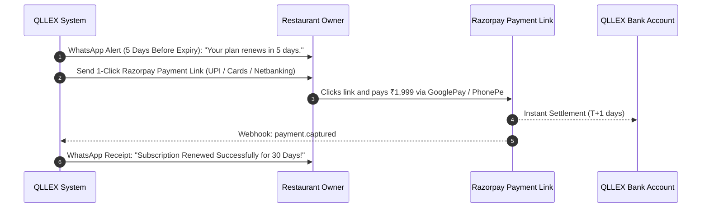

# 🛠️ SaaS Management & Operations SOP
## How to Manage 50+ Hotels Smoothly with a 1-Person Team

SaaS ka sabse bada benefit yeh hai ki aapko har customer ke office nahi jana padta. 

Aap apne ghar ya office mein baith kar **50 se 100 hotels ka software akele manage kar sakte hain**, agar aapke paas sahi operational processes aur tools hon!

---

## 1. Daily Operations: Subah aur Shaam Ka 15-Minute Routine



### Free Monitoring Tools to Setup:
1. **UptimeRobot (Free):**
   - Register at [uptimerobot.com](https://uptimerobot.com).
   - Create HTTP monitor for: `https://api.yourdomain.com/api/health`.
   - Interval: Every 5 minutes.
   - Alert: Instant SMS/WhatsApp/Email notification agar server 1 minute ke liye bhi down ho jaye.
2. **MongoDB Atlas Email Alerts:**
   - Atlas dashboard mein **Alerts** enable karein jab storage 75% exceed kare ya connection pool 80% cross kare.

---

## 2. Pushing Updates Without Breaking Live Restaurants (Zero-Downtime)

Aapka backend Railway par aur frontend Vercel par deployed hai. Iska matlab updates push karna super-smooth hai:

```powershell
# 1. First test changes locally
npm run dev

# 2. Commit and push to main branch
git add .
git commit -m "feat: added dish spice level filter"
git push origin main
```

### What Happens Behind the Scenes?
- **Vercel** instant edge rebuild karega. Jab tak naya build verify nahi hota, purana version users ko serve hota rehta hai (Zero seconds downtime!).
- **Railway** naya container build karke health check karega, fir traffic ko naye container par route karega aur purane container ko safely terminate karega.

### Rules for Safe SaaS Updates:
> [!WARNING]
> **Production Code Safety Rules:**
> 1. **Never Rename or Delete Fields in Database Models:** Agar `price` field hai, toh use delete mat karein. Hamesha naye fields ko optional (`default: null` ya `default: false`) rakhein.
> 2. **Never Deploy During Peak Dining Hours:** Kabhi bhi dopehar 1:00 PM – 2:30 PM ya raat 8:00 PM – 10:30 PM ke beech code push mat karein! Hamesha subah 10 AM ya dopehar 4 PM par updates deploy karein jab restaurant rush zero hota hai.

---

## 3. Subscription Billing & Payment Collection System

Har mahine 50 hotels se subscription fees collect karna complex nahi hona chahiye:



### Razorpay Payment Links (Simplest Solution):
1. Razorpay dashboard mein **Payment Links** tab par jayein.
2. Click **Create Payment Link**:
   - Amount: ₹1,999 (ya ₹999).
   - Description: *Spice Villa - QLLEX SaaS Subscription (Month: July 2026)*.
   - Customer Mobile: Owner ka WhatsApp number.
3. Link WhatsApp par share ho jata hai. Owner Google Pay ya PhonePe se 10 seconds mein pay kar deta hai.

---

## 4. WhatsApp-First Customer Support SOP

Indian restaurant owners email ticket open nahi karte; unhe instant WhatsApp reply chahiye hota hai:

1. **Setup WhatsApp Business App:**
   - Profile Name: **QLLEX Technologies — Hotel Support**
   - Business Hours: 9:00 AM to 11:30 PM (Covers full restaurant hours).
   - Automated Welcome Message:
     *"Namaste! QLLEX Hotel Support mein aapka swagat hai. Apna Restaurant Name aur query share karein, hamare technical executive 15 minutes mein revert karenge."*
2. **Standard Quick Replies (Shortcuts):**
   - `/qr` $\rightarrow$ *"Sir, QR code download karne ke liye Admin Portal > Tables > Download QR par click karein."*
   - `/menu` $\rightarrow$ *"Sir, nayi dish add karne ke liye Admin Portal > Menu Items > Add New Item par jayein."*
   - `/printer` $\rightarrow$ *"Sir, thermal printer connect karne ke liye USB cable connect karein aur Browser Print settings mein '58mm Paper' select karein."*

---

## 5. Handling Delinquent / Expired Accounts Gracefully

Agar koi restaurant time par payment na kare:
- **Day 0 (Expiry Date):** System band mat karein! WhatsApp friendly reminder bhejein.
- **Day +3 (Grace Period):** Counter manager ko call karein: *"Sir, aapka subscription renew hone wala hai, link WhatsApp par bheja hua hai."*
- **Day +5 (Soft Lock):** Admin portal par ek banner show karein: *"Subscription Overdue. Please renew to keep taking orders."* (Customer menu abhi bhi view ho sakta hai).
- **Day +7 (Hard Lock):** Account suspend karein (`isActive: false`).
