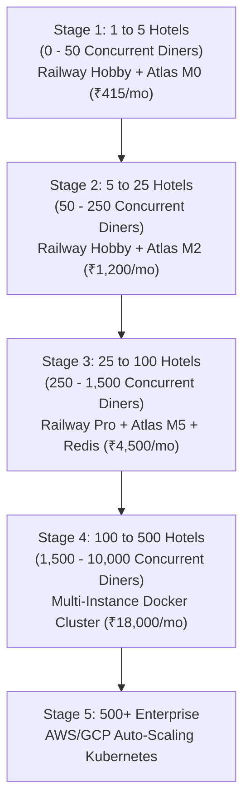

# 📈 Scaling & High-Performance Architecture Guide
## From 1 Hotel to 500+ Hotels Without System Crashes

Jab 50 restaurants mein weekend dinner time (Saturday 8:30 PM) par hazaron customers ek sath QR code scan karenge, toh aapka backend crash hoga ya rock-solid chalega?

Is guide mein hum beginner-friendly Hinglish mein explain karenge ki aapka system kaise scale karega aur kis stage par kya technical upgrade karna hoga.

---

## 1. The 5 Scaling Milestones



---

## 2. Milestone Deep-Dive: Infrastructure & Bottlenecks

### Stage 1: 1 to 5 Hotels (Current Launch Phase)
- **Concurrent Users:** ~20–50 users at peak dinner hours.
- **Infrastructure:**
  - Frontend: Vercel Hobby (Free)
  - Backend: Railway Hobby (512MB RAM, shared vCPU)
  - Database: MongoDB Atlas M0 (Free 512MB storage, max 500 connections)
- **Bottlenecks:** None. System response time will be ultra-fast (< 80ms).

---

### Stage 2: 5 to 25 Hotels (Early Traction)
- **Concurrent Users:** ~80–250 users browsing menus and placing orders.
- **Infrastructure Upgrade Required:**
  - Upgrade MongoDB Atlas from M0 to **Atlas M2 ($9/mo, ~₹750)**.
  - *Kyun?* M0 cluster par automated daily backups nahi hote aur 500 connection limit hoti hai. M2 par 1,500 connections aur daily snapshots milte hain.
- **Code Optimization:**
  - Har Mongoose read query mein `.lean()` add karein (e.g. `MenuItem.find(...).lean()`). Isse memory usage 60% kam ho jati hai kyunki Mongoose heavy model wrappers instantiate nahi karta.

---

### Stage 3: 25 to 100 Hotels (Growth Phase)
- **Concurrent Users:** ~300 to 1,500 active diners.
- **Total Orders:** ~5,000 orders / day.
- **Critical Technical Changes:**

#### Change A: Image Storage Offloading (Crucial!)
Abhi dish images local server disk (`backend/uploads/`) par save ho rahi hain. Jab 50 restaurants 500 dishes upload karenge, toh server disk full ho sakti hai.
- **Solution:** Free/Low-cost Cloud Storage use karein: **Cloudinary** ya **AWS S3 + Cloudflare R2**.
- Images automatically optimize ho jayengi (WebP format, resized thumbnail) jisse customer ke phone par menu 0.3 seconds mein load ho jayega!

#### Change B: Redis Adapter for Socket.io
Agar aapko backend ke 2 instances chalane hain load balancing ke liye:
- Normal Socket.io memory mein rooms maintain karta hai. Agar Waiter Instance 1 se connected hai aur Customer Instance 2 se, toh message deliver nahi hoga!
- **Solution:** Add `@socket.io/redis-adapter` with a free Upstash Redis instance (Zero devops, $0 to $5/mo). Dono instances instantly sync ho jayenge.

---

### Stage 4: 100 to 500 Hotels (Enterprise Scale)
- **Concurrent Users:** 2,000 to 10,000 simultaneous users.
- **Revenue:** ₹1.5 Lakhs to ₹7.5 Lakhs / month.
- **Infrastructure:**
  - 3x Horizontally Scaled Node.js Docker containers behind Railway / DigitalOcean Load Balancer.
  - MongoDB Atlas M10 Dedicated 3-Node Replica Set (Mumbai Region).
  - In-Memory Redis Caching: Restaurant menu ko Redis mein 1 ghante ke liye cache karein (`GET /menu/public/:restaurantId/items`). Database queries 90% drop ho jayengi!

---

## 3. Database Indexing: Already Implemented in Your App!

Aapke models mein humne pehle hi standard compound indexes laga diye hain:

```javascript
// Order Model (order queries instant execute hoti hain chahe 10 lakh orders hon)
orderSchema.index({ restaurant: 1, tableSession: 1 });
orderSchema.index({ restaurant: 1, status: 1 });
orderSchema.index({ restaurant: 1, createdAt: -1 });

// Payment Model
paymentSchema.index({ restaurant: 1, paymentStatus: 1 });
paymentSchema.index({ restaurant: 1, paidAt: -1 });

// Menu Model (Food searches with text index)
menuItemSchema.index({ restaurant: 1, category: 1 });
menuItemSchema.index({ restaurant: 1, isAvailable: 1 });
menuItemSchema.index({ restaurant: 1, name: 'text', description: 'text' });
```

In indexes ki wajah se MongoDB ko pura collection scan nahi karna padta; queries milliseconds mein return hoti hain!
