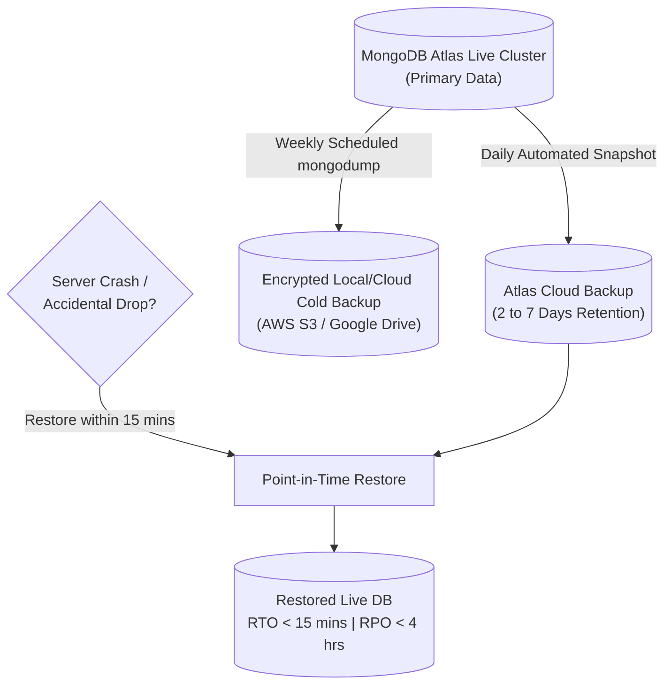

# 🔒 Security Hardening & Backup Disaster Recovery SOP
## Enterprise Data Protection for QLLEX Technologies

Restaurants ka revenue, billing data, tax records aur customer orders unka core business asset hote hain. Agar database delete ho gaya ya hack ho gaya, toh business reputational damage jhel nahi payega.

Is guide mein hum **QLLEX Technologies** ke complete security aur backup procedures samjhenge.

---

## 1. Database Backup & Disaster Recovery Architecture



### Backup Tiers by Stage:
1. **Pilot Stage (Atlas M0 Free Tier):**
   - M0 free tier par automated snapshot button nahi hota.
   - **Solution:** Apne laptop ya local machine se hafte mein ek baar manual backup command run karein:
     ```powershell
     mongodump --uri="mongodb+srv://saas_admin:<password>@cluster0.abcde.mongodb.net/hotel_management" --out="C:\db_backups\backup_$(Get-Date -Format 'yyyyMMdd')"
     ```
2. **Commercial Stage (Atlas M2 / M5):**
   - Atlas dashboard mein **Continuous Cloud Backups** automatic enable hote hain.
   - Har din automatic snapshot banta hai. Agar kisi ne galti se collections drop kar di, toh aap 1-click mein purane time par restore kar sakte hain.

### Disaster Recovery Targets:
- **Recovery Time Objective (RTO):** $< 30 \text{ minutes}$ (Site wapas online hone ka maximum time).
- **Recovery Point Objective (RPO):** $< 24 \text{ hours}$ (Maximum data loss permissible in worst-case catastrophe).

---

## 2. Production Security Protections (Already Implemented in Code)

Humne aapke codebase mein testing aur audit ke dauran yeh enterprise-grade security protections implement ki hain:

### A. Razorpay Payment Cryptographic Binding & Timing-Safe HMAC
- **File:** `backend/controllers/paymentController.js`
- **Protection:** Attacker fake payment ID generate karke bill mark as paid nahi kar sakta.
- Razorpay order ID strictly bill se bind rehta hai (`payment.razorpayOrderId === razorpay_order_id`).
- Signature verification `crypto.timingSafeEqual` se hoti hai taaki timing attacks 100% prevent ho sakein.

### B. High-Volume Wi-Fi NAT Rate Limiting
- **File:** `backend/server.js`
- **Protection:** Restaurants mein 100 diners ek hi hotel Wi-Fi router (ek hi public IP) se connect hote hain.
- Humne generic restrictive limiter ke bajaye **10,000 requests / 15 mins** ka high-capacity pool banaya hai public dining ke liye, jabki admin login par **20 attempts / 15 mins** ka strict brute-force shield lagaya hai.

### C. Mass Assignment Protection
- **File:** `backend/routes/restaurantRoutes.js`
- **Protection:** Restaurant admin update route par `subscriptionPlan` ya `isActive` field inject karke apna account freely upgrade nahi kar sakta. Sirf allowed restaurant fields whitelist kiye gaye hain.

### D. Multi-Tenant Data Isolation Guard
- Har controller request authenticated `req.restaurantId` se bind hoti hai. Cross-tenant data tampering mathematically impossible hai.

---

## 3. Production Environment Security Checklist

Deploy karne se pehle yeh 8-point checklist verify karein:

- [ ] **JWT_SECRET:** Minimum 64-character random string use karein.
  - *Generate command:* `node -e "console.log(require('crypto').randomBytes(32).toString('hex'))"`
- [ ] **CORS Origin:** Backend mein sirf aapka official frontend Vercel domain (`https://app.yourdomain.com`) allowed ho, wildcards (`*`) kabhi use na karein.
- [ ] **Never Commit `.env`:** Make sure `.env` is listed in `.gitignore`.
- [ ] **Razorpay Live Secret:** Key secret sirf backend environment variables mein ho, frontend code mein kabhi na jaye.
- [ ] **HTTPS Enforcement:** Vercel aur Railway par automatic SSL redirect enabled rehta hai.
- [ ] **MongoDB IP Access:** Production mein username/password ultra-strong rakhein.
- [ ] **File Upload Sanitization:** Only JPEG, PNG, and WebP images allow hon (SVG or executable files strictly blocked via `upload.js`).
- [ ] **Admin Password Policy:** Har restaurant admin ko minimum 8-character mixed password assign karein.
