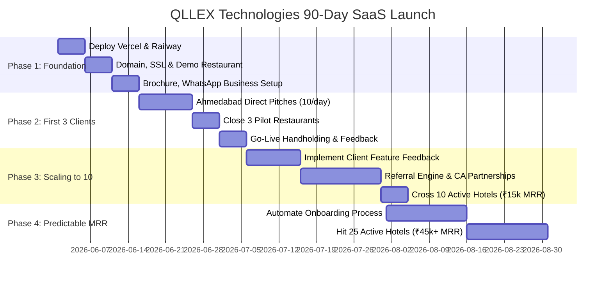

# 📅 90-Day Execution Roadmap & Revenue Milestones
## From Zero to ₹50,000+ Monthly Recurring Revenue (MRR)

Pehle 90 din kisi bhi SaaS startup ke liye sabse critical hote hain. Agar planning structured na ho, toh founder coding mein hi uljha rehta hai aur sales kabhi shuru nahi hoti.

Yeh 90-day day-by-day roadmap **QLLEX Technologies** ko first 25 paying restaurants onboard karne ka clear path deta hai.

---

## 1. High-Level 90-Day Timeline

---

## Phase 1: The Foundation (Days 1 to 15)
**Goal:** Ek beautiful live demo environment ready karna jisko dekhkar restaurant owner turant "YES" bol sake.

- **Day 1–3: Cloud Deployments**
  - Backend ko Railway par deploy karein.
  - MongoDB Atlas M0 cluster connect karein.
  - Frontend ko Vercel par live karein.
- **Day 4–6: Branding & Domain Setup**
  - Custom domain buy karein (e.g. `qllexhotels.com` ya `app.yourcompany.in`).
  - DNS records connect karein with free SSL.
- **Day 7–9: Pre-Loaded Demo Restaurant Setup**
  - Ek mock restaurant create karein: *"The Urban Grill & Cafe"*.
  - 25 attractive dishes upload karein with clean images and prices.
  - Table 01 to Table 05 create karein aur 2 acrylic standees print karwayein.
- **Day 10–12: Sales Collateral**
  - 1-Page A4 laminated brochure design karein (Canva free account se):
    - Title: *"Aapka Apna Smart QR Dining Portal — Zero Commission!"*
    - Key Features: Fast ordering, live kitchen screen, GST billing, UPI payment.
    - Pricing: ₹1,999/month.
- **Day 13–15: Communication Channels**
  - WhatsApp Business profile setup karein.
  - 45-second demo screen recording video banayein phone par.
- **Expense for Phase 1:** ~₹1,500 (Domain + 2 Acrylic Standees + 20 Brochures).

---

## Phase 2: The First 3 Paying Customers (Days 16 to 30)
**Goal:** ₹5,000+ MRR achieve karna aur pehle 3 restaurants ko live run karwana.

- **Day 16–22: Street-Level Field Work (Ahmedabad)**
  - Target areas: CG Road, Vastrapur Lake surroundings, Prahlad Nagar food street.
  - Daily Target: 8 se 10 restaurant walk-ins between 3:30 PM and 6:00 PM.
  - Total conversations: 50+ restaurant owners.
- **Day 23–26: The "7-Day Free Pilot" Close**
  - 5 interested owners ko 7-day risk-free pilot offer karein.
  - Pre-requisite: Menu photo lein aur usi shaam menu digitize karein.
- **Day 27–30: Go-Live & First Conversions**
  - Unke tables par QR standees lagayein.
  - Lunch time par staff ko 30-minute training dein.
  - **Milestone:** Day 30 par 3 restaurants convert ho kar paying customers ban jate hain!
  - **Revenue Milestone:** 3 $\times$ ₹1,999 = **₹5,997 / month MRR!**

---

## Phase 3: Growth to 10 Hotels (Days 31 to 60)
**Goal:** ₹15,000 to ₹20,000 MRR reach karna through word-of-mouth and partnerships.

- **Day 31–38: Bug Fixing & Polish**
  - First 3 restaurants se aane wale feedback aur user friction ko fix karein.
  - System super-stable ban jata hai.
- **Day 39–48: The Video Proof Strategy**
  - First 3 restaurant owners ke counter par 30-second ka video review shoot karein:
    - *"QLLEX software lagane ke baad hamari waiter dependency kam ho gayi hai aur billing fast ho gayi hai."*
  - Is video ko WhatsApp par baaki 50 restaurant leads ko share karein.
- **Day 49–60: Expansion to Surat & Vadodara or Deep Ahmedabad**
  - 10 active restaurants close karein.
  - **Revenue Milestone:** 10 $\times$ ₹1,999 = **₹19,990 / month MRR!**
  - Total hosting cost: ₹1,265/mo. Net profit: **₹18,725/mo!**

---

## Phase 4: Systematization & Scaling to 25+ Hotels (Days 61 to 90)
**Goal:** Business ko repeatable banana jahan aapko code touch na karna pade, sirf sales aur growth par focus ho.

- **Day 61–75: CA & Consultant Referral Channel**
  - 5 local restaurant accounting firms ko 15% recurring affiliate partner banayein.
- **Day 76–85: Annual Plan Upsell**
  - Existing customers ko offer dein: *"Pay for 10 months (₹19,999) and get 2 months + Free Acrylic Standees worth ₹2,500 FREE!"*
  - 4 customers saal ka upfront pay karte hain = **₹80,000 instant cashflow!**
- **Day 86–90: Day 90 Celebration & Hiring Intern**
  - Milestone achieved: **25 Active Hotels**.
  - **Monthly Recurring Revenue (MRR):** **₹45,000 to ₹55,000 / month!**
  - Ek college intern ya customer support executive hire karein (₹8,000–₹10,000/mo) for daily menu updates.

---

## 3. The 90-Day Master Scorecard

| Metric | Day 1 | Day 30 | Day 60 | Day 90 |
| :--- | :--- | :--- | :--- | :--- |
| **Active Paying Hotels** | 0 | 3 | 10 | **25** |
| **Monthly Revenue (MRR)**| ₹0 | ₹5,997 | ₹19,990 | **₹48,725** |
| **Cloud Hosting Cost** | ₹0 | ₹515 | ₹1,265 | **₹3,400** |
| **Net Monthly Profit** | -₹1,500 (Setup) | +₹5,482 | +₹18,725 | **+₹45,325 / month** |
| **Hours Worked / Week** | 30h (Coding/Setup) | 25h (Field Sales) | 20h (Onboarding) | **10h (Management)** |
